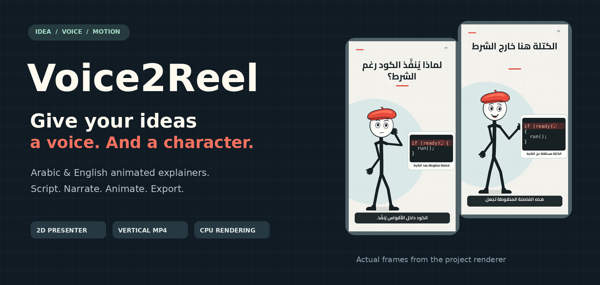
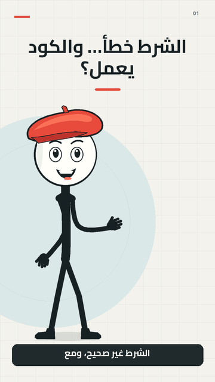
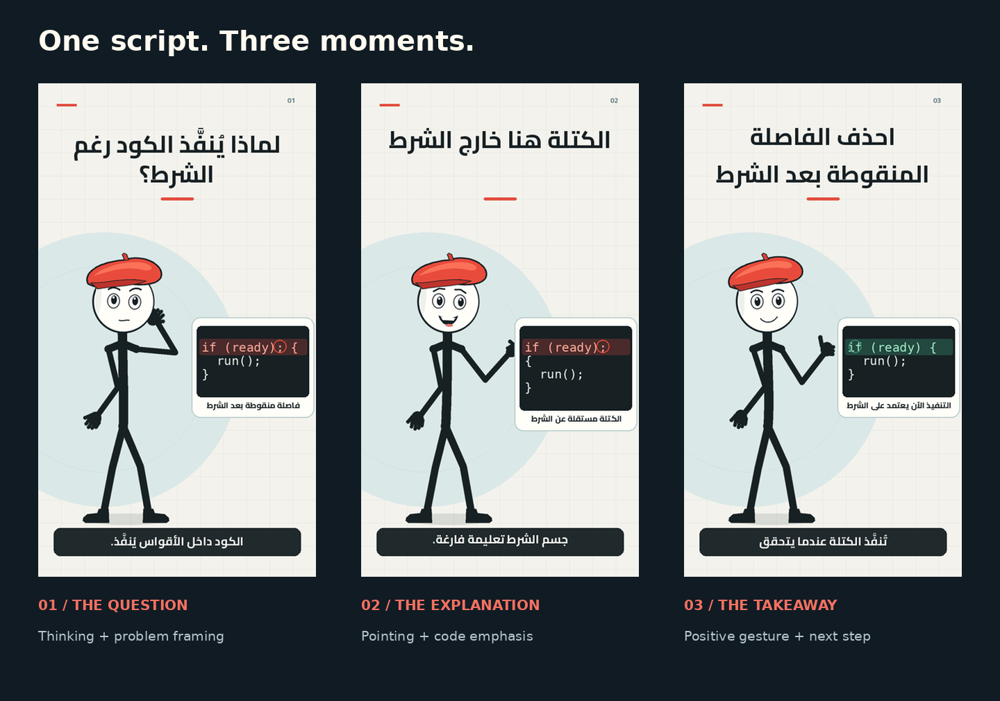

<p align="center">
  
</p>

<p align="center">
  <a href="#quick-start"><strong>Get started</strong></a> ·
  <a href="#see-it-in-motion"><strong>See it in motion</strong></a> ·
  <a href="docs/FAST_PRESENTER.md"><strong>الدليل بالعربية</strong></a> ·
  <a href="#development"><strong>Development</strong></a>
</p>

<p align="center">
  
  
  
  
</p>

# Voice2Reel

**Create narrated, vertical videos with an animated 2D presenter — in Arabic or English.**

Voice2Reel combines a structured script, speech synthesis, character animation, explanatory graphics, music, and sound effects into an MP4. Start with a reviewed script for direct control, or use the optional AI writer to turn an idea into a draft.

The current release is a **local Python prototype** with a command-line workflow and Colab notebooks. It does not include a hosted web application. AI-written scripts need human review before publication.

## See it in motion

<p align="center">
  
</p>

<p align="center"><sub>Actual project renderer · 9-second visual preview · silent GIF</sub></p>

The preview shows the renderer's gestures, expressions, captions, and code highlighting. It uses synthetic audio energy and demonstration timing to animate the mouth; it does not demonstrate speech synthesis or word alignment.



## What it does

- **Arabic and English narration:** online neural speech by default, with optional Piper speech and XTTS voice cloning.
- **Animated presenter:** expressive faces, six gestures, camera framing, and audio-driven mouth movement.
- **Explanatory visuals:** captions, diagrams, labels, and code panels with explicit highlighting.
- **Sound design:** generated instrumental background music, timed effects, and music ducking during speech.
- **Editable output:** separate narration, music, effects, timing metadata, and the final video.
- **Incremental rendering:** independent caches for scripts, speech, mixing, and video reduce repeated work when you edit a project.

| Output profile | Resolution | Frame rate |
| --- | --- | --- |
| `fast` (default) | 540 × 960 | 24 FPS |
| `quality` | 720 × 1280 | 30 FPS |

## Quick start

### Run locally

Use **Python 3.12 on Linux**, with FFmpeg and DejaVu Sans Mono installed. The repository also bundles the Cairo font and its SIL Open Font License.

On Ubuntu/Debian, install the system dependencies:

```bash
sudo apt-get update
sudo apt-get install -y ffmpeg fonts-dejavu-core
```

Then install the presenter in a virtual environment:

```bash
git clone https://github.com/garaahmad/Voice2Reel.git
cd Voice2Reel
python3.12 -m venv .venv
source .venv/bin/activate
python -m pip install -r requirements/presenter.txt

python -m voice2reel.presenter \
  --script examples/presenter_v2/semicolon_ar.json \
  --output outputs/presenter
```

The example uses a **manually reviewed Arabic script**. It requires no GPU, Torch, text-model download, or reference recording. Internet access is required for the default speech service.

### Run in Colab

Open [04_fast_stickman.ipynb](notebooks/04_fast_stickman.ipynb) in Colab and follow its setup cells. See the [Arabic walkthrough](docs/FAST_PRESENTER.md) for the reviewed-example and idea-generation workflows. Execution on an actual Colab allocation has not been benchmarked here.

## How the pipeline works

```text
Reviewed script ──────────────────────┐
                                    ├─→ Speech → Animation + audio mix → MP4
Idea → Optional AI writer → Review ──┘
```

The character is drawn by the Python renderer. The optional Qwen3 4B writer generates script text; it does not generate the character artwork.

A script defines narration, captions, gestures, camera framing, and explanatory visuals for each scene. See the [Arabic example](examples/presenter_v2/semicolon_ar.json) for the structure and the [presenter guide](docs/PRESENTER_V2.md) for visual fields and sound settings.

The output directory includes:

| File | Contents |
| --- | --- |
| `script.json` | The script used for the video |
| `narration.wav` | Raw speech used to drive mouth movement |
| `music.wav` / `effects.wav` | Separate background music and effects |
| `soundtrack.wav` / `soundtrack.json` | Final audio mix and mix metadata |
| `video.mp4` | Rendered vertical video |
| `progress.json` | Pipeline status, including failures |

Timing metadata and performance reports are also saved. Visual edits can reuse unchanged speech; music edits rebuild the mix and video. An identical request can reuse the cached video. Avoid running two jobs against the same output directory.

## Choose a voice

| Engine | Use | Requirements |
| --- | --- | --- |
| `edge` (default) | Online neural narration | Internet access to Microsoft's speech service |
| `piper` | Local preset narration | Initial voice-model download; local inference afterward |
| `xtts` | Optional reference-voice cloning | Additional dependencies, model downloads, and a reference recording |

The default engine uses `edge-tts==7.3.1` with `ar-JO-TaimNeural` for Arabic and `en-US-GuyNeural` for English. **Narration text is sent to Microsoft's external service.** These voices are not project-trained weights. The client is unofficial, service availability can vary, and the pipeline reports failure without automatically switching engines.

```bash
# Local Piper speech after the initial model download
python -m voice2reel.presenter \
  --script examples/presenter_v2/semicolon_ar.json \
  --voice-engine piper --output outputs/piper

# Adjust online speech speed
python -m voice2reel.presenter \
  --script examples/presenter_v2/semicolon_ar.json \
  --speech-rate 5 --output outputs/faster
```

For XTTS, install `requirements/voice.txt` in addition to the presenter dependencies and select `--voice-engine xtts --reference voice.wav`. This path has additional compute and model requirements.

## Customize the video

```bash
# Higher-resolution output
python -m voice2reel.presenter \
  --script examples/presenter_v2/semicolon_ar.json \
  --profile quality --output outputs/quality

# Disable music and sound effects
python -m voice2reel.presenter \
  --script examples/presenter_v2/semicolon_ar.json \
  --no-music --no-sfx --output outputs/quiet

# Supply a music file you have permission to use
python -m voice2reel.presenter \
  --script examples/presenter_v2/semicolon_ar.json \
  --music music.mp3 --output outputs/custom
```

Run `python -m voice2reel.presenter --help` for all options.

## Generate a script from an idea

Idea mode adds a text model to the presenter workflow. For the CPU backend, install a C/C++ build toolchain and CMake, then run:

```bash
CC=gcc CXX=g++ \
CMAKE_ARGS="-DGGML_CUDA=OFF -DLLAMA_CURL=OFF" \
CMAKE_BUILD_PARALLEL_LEVEL=2 \
python -m pip install --no-binary llama-cpp-python -r requirements/director-cpu.txt

python -m voice2reel.presenter \
  --idea "Explain a programming idea" \
  --interactive --device cpu --output outputs/my-reel
```

Five questions capture the audience, duration, language, facts, and visual focus. The pinned Qwen3 4B CPU backend downloads approximately **2.5 GB** on first use. CUDA requires a compatible Torch build and `requirements/text.txt`; the Colab notebook handles the choice of CPU/GPU dependencies in idea mode.

The writer validates structure and language, and may make one correction attempt after validation fails. Use `--text-attempts 1` to disable that retry. These checks do not verify factual accuracy or editorial quality. Review the resulting script before sharing it; the [writing review examples](examples/presenter_v2/writing_review/README.md) document observed limitations.

## Development

Install the development tools alongside the presenter dependencies:

```bash
python -m pip install -r requirements/dev.txt
ruff check .
python scripts/check_data.py

# Presenter, audio, rendering, evaluation, and notebook checks
pytest -q tests/test_presenter.py tests/test_sound_design.py \
  tests/test_render.py tests/test_motion_preview.py \
  tests/test_evaluation.py tests/test_notebooks.py
```

Rendering tests use synthetic narration and exercise FFmpeg without calling an online voice service. The full `pytest -q` suite also covers training, XTTS, and experimental video tools; it needs additional dependencies. See the [CI workflow](.github/workflows/tests.yml) for that setup.

## Additional tools

The repository retains training and voice experiments alongside the current presenter:

| Notebook | Purpose |
| --- | --- |
| [04_fast_stickman](notebooks/04_fast_stickman.ipynb) | Current presenter, narration, music, and effects |
| [00_ready_voice_ar_en](notebooks/00_ready_voice_ar_en.ipynb) | Original preset XTTS narration |
| [01_scriptwriter_qlora](notebooks/01_scriptwriter_qlora.ipynb) | Original 1.5B QLoRA scriptwriter training |
| [02_arabic_voice_xtts](notebooks/02_arabic_voice_xtts.ipynb) | XTTS cloning and fine-tuning |

Older 1.5B adapters are incompatible with the current Qwen3 4B writer. No newly trained weights are shipped. Realistic-video notebook 03 and earlier motion studies are historical experiments, separate from the current presenter workflow.

## Current limitations

- Mouth animation follows audio energy; it is not phoneme-level lip sync.
- Gestures come from a fixed vocabulary. The renderer does not generate arbitrary character movements.
- Code panels display script-provided content and highlights; they do not execute or verify code.
- AI-generated Arabic can need substantial editing. The reviewed example is not raw model output.
- Runtime depends on video settings, speech-service latency, model downloads, and cache state. The [earlier CPU benchmark](examples/fast_presenter/benchmark.local.json) measures the previous renderer and Piper voice, not the current version. See [v2 observations](examples/presenter_v2/measurements.json) for separate measurements.
- GPU execution has not been benchmarked here. Reference-video analysis is not an automatic pipeline feature.

## Documentation and third-party terms

- [Presenter design, audio, and output guide — Arabic](docs/PRESENTER_V2.md)
- [Colab walkthrough — Arabic](docs/FAST_PRESENTER.md)
- [Current examples and review notes](examples/presenter_v2/README.md)
- [Research, sources, and license notes](docs/RESEARCH.md)

Piper, its voice data, XTTS, and the online speech service have separate terms. The bundled Cairo font includes its license. The repository does not redistribute Instagram video assets, voice weights, or third-party music recordings.
