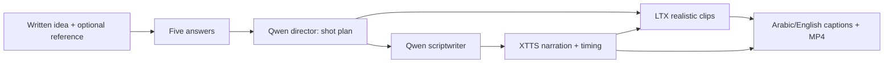

# Voice2Reel

Turn a **written idea** into a short video with **realistic AI-generated scenes** and Arabic or English AI narration. A reference video and a voice-cloning recording are optional, separate inputs.

**Status: experimental local/Colab toolkit.** The director, scriptwriter, speech, video-generation adapter, captioning, and assembly code are implemented. Actual Qwen and XTTS inference has run on CPU. Full realistic video generation with the LTX weights and free-Colab GPU execution have **not** been verified. No custom-trained model weights are shipped; the web application and server job queue remain future work.

## The workflow

1. Enter a written idea; optionally provide a reference video.
2. Answer at most **five questions**: audience, duration, narration language, setting/characters, and the key message or facts.
3. Qwen acts as a director: it writes a continuity description, shot prompts, camera/action descriptions, and beginning/end actions.
4. A second Qwen pass writes narration following those shots. Review or edit the script.
5. XTTS generates a ready-made AI voice in Arabic or English; optional voice cloning remains available.
6. Actual speech timing determines each clip's frame range. LTX generates the visuals; the tools add captions and mux the narration into MP4.



The director plans **shots and key moments**, not independent prompts for every image. The video model generates the intervening frames jointly. `timeline.json` records exact frame ranges; it is not a guarantee of frame-level control. The optional reference currently supplies the **first frame for the first clip**, not analysis of the entire reference video. Character identity across separately generated shots is not guaranteed.

## Run on Colab

Download this private repository as ZIP using GitHub **Code → Download ZIP**. Open a notebook in Colab using **File → Upload notebook**, choose a GPU runtime, and upload the repository ZIP when its first setup cell asks for it. Results are saved to Google Drive.

| Goal | Notebook |
|---|---|
| New realistic video workflow | [03_realistic_video.ipynb](notebooks/03_realistic_video.ipynb) |
| Ready Arabic/English voice only | [00_ready_voice_ar_en.ipynb](notebooks/00_ready_voice_ar_en.ipynb) |
| Train the scriptwriter with QLoRA | [01_scriptwriter_qlora.ipynb](notebooks/01_scriptwriter_qlora.ipynb) |
| Optional voice cloning and fine-tuning | [02_arabic_voice_xtts.ipynb](notebooks/02_arabic_voice_xtts.ipynb) |

Start with the **[Arabic realistic-video guide](docs/REALISTIC_VIDEO.md)**. The default video profile is a **288×512, 24 FPS preview**, with one short clip tested before the full job. Model downloads are large; allow roughly 25 GB of free disk. Free-Colab GPU availability, memory sufficiency, runtime, and visual quality are not guaranteed. Higher resolution needs more GPU memory. No paid service or OpenAI model is used by this pipeline.

## Local commands

Use Python 3.12, ffmpeg, an Arabic-capable font, and a CUDA GPU for video. Install a compatible torch/torchaudio build first, then:

```bash
python -m pip install -r requirements/voice.txt -r requirements/video.txt
python -m voice2reel.director --idea "A realistic video about a beginner programming mistake" --output outputs/realistic
python -m voice2reel.voice.synthesize --script outputs/realistic/script.json --output outputs/realistic/narration.wav
python -m voice2reel.realistic --project outputs/realistic --max-clips 1
python -m voice2reel.realistic --project outputs/realistic
```

The director asks five questions. Use `--brief examples/realistic_semicolon/brief.json` instead for a reproducible brief. For a reference video, add `--reference-video /path/to/reference.mp4` to the director command. For voice cloning, add `--reference /path/to/voice.wav` to speech synthesis. Otherwise a preset AI voice is selected automatically.

Each model runs in a separate process to release memory before the next stage. Completed clips resume after interruption using model/settings/timeline signatures and content hashes. Editing narration requires regenerating audio. Changed timing or visual settings invalidates the clip cache.

## Models, data, and limits

| Component | Model | Role |
|---|---|---|
| Director and scriptwriter | Qwen2.5-1.5B-Instruct | Two sequential text passes, structural validation, up to three repair attempts |
| Narration | XTTS-v2 | Preset Arabic/English voice; optional reference voice |
| Video | LTX-Video-0.9.5, 2B transformer | Text/image-conditioned realistic clips; experimental GPU integration |

All base revisions are pinned in code. The training kit includes 40 authored script examples and 120 recording prompts, **not a production dataset or recorded speech**. Existing script training covers narration and legacy visual beats; it does not train the new director schema. Director/video fine-tuning is not implemented. Voice training needs real recordings with matching transcripts.

JSON validation cannot guarantee factual correctness, pronunciation, visual consistency, or instruction following. The original semicolon demo exposed a factual error; review educational scripts before publishing. Video models struggle with readable text and code, so captions are drawn afterward. This workflow does not provide lip sync, music generation, or complete reference-video analysis.

XTTS weights and outputs use the **non-commercial CPML license**. See [research/licensing notes](docs/RESEARCH.md), [dataset provenance](datasets/README.md), [evaluation](docs/EVALUATION.md), and [verification record](docs/VALIDATION.md).

## Existing demo and implementation

The [original stickman demo](docs/VIDEO_DEMO.md) used actual Qwen and XTTS inference plus a fixed Pillow renderer. It remains a functional baseline. The previous product/renderer proposal is retained in [legacy design notes](docs/LEGACY_DESIGN.md).

- `voice2reel/director.py`, `storyboard.py`: five-question brief, director → narration, frame timeline.
- `voice2reel/realistic.py`: staged T5/LTX loading, image conditioning, resumable clips, captions, MP4 assembly.
- `voice2reel/scriptwriter/`, `voice2reel/voice/`: training and inference tools.
- `notebooks/`: four Colab entry points.
- `tests/`: data, model API, timeline, encoding, and training machinery checks.
